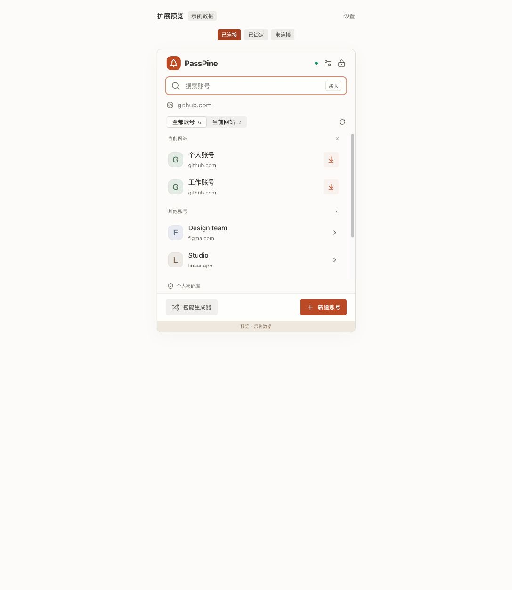

# 功能与验证记录

日期：2026-10-15（Asia/Shanghai）。环境：macOS / Apple M4 Pro，Go 1.27.1，Node 24.21.0。所有密码测试使用临时目录和虚构账号。

## 既有完整检查记录

| 检查 | 结果与范围 |
| --- | --- |
| `bash scripts/check.sh` | Go 全包 race tests、vet，真实编译 Host 的 stdin/stdout 进程测试，TypeScript 与 31 项扩展测试通过 |
| Go OpenPGP ↔ GnuPG | 两端生成的密文双向解密；GPG 受保护私钥导出、secret-subkeys / GNU dummy 主钥、混合公有及私有子钥兼容测试通过 |
| 系统 GPG 自动匹配 | 隔离密钥环验证根目录与嵌套策略、短 ID / 邮箱、多收件人及公钥保留；缺失私钥、错误口令、歧义、超大导出和锁定取消保护通过；原生导入页无需私钥文件 |
| 密码库安全回归 | 路径穿越、符号链接、篡改密文、版本冲突、重命名目标策略、多收件人、超时、锁定取消、加密草稿 / 回收站、备份可读性通过 |
| Git | 临时本地 / bare 仓库克隆、限定暂存、冲突保护、慢网络读取不阻塞、写入 busy 通过；本轮已改为锁定继续、关闭取消，旧断言已更新但未重跑完整功能套件；未连接个人远端 |
| 实际 Go Host 进程 | 使用构建后的 passpine-host，连续 configure / fetch / error / lock / unlock 往返，共用应用会话，requestId 保持；测试不启动浏览器 |
| 原生 UI | MyGo / Onevra native 模式编译并实际启动；通过 macOS UI 工具选择条目并检查隐藏密码 / OTP / 详情布局；关键页面另有 headless render 与交互测试 |
| 浏览器交互预览 | Chrome 检查紧凑列表、四个条目操作、主题色交互、锁定名称搜索；纯示例数据 |
| 系统解锁与设置 | Swift 设备封装加密和跨库拒绝通过，未触发真实指纹验证；Go 检查关闭撤销、锁定取消、浏览器权限边界、自动保存合并与提示 |
| 扩展逻辑 | 31 项测试涵盖持久 Port、断线不重放、请求关联、会话版本、晚到响应、精确网站匹配、字段与换行保留、跨端备注，以及 jsdom 中实际表单填写与事件 / URL / frame 检查 |
| 构建产物 | macOS `.app` 本地签名验证、Chrome / Firefox MV3 构建和 ZIP 生成通过 |

最后一次完整检查以 `scripts/check.sh` 的退出码为准。单独 `go test ./...` 未设置 `PASSPINE_NEO_TEST_HOST` 时会跳过“真实辅助进程”用例；完整脚本会先构建助手并设置环境变量。

## 本轮视觉与 Git 调整

- 原生 23 个页面 / 状态生成 69 张截图：1120×760 浅色、860×620 窄窗口和 1120×760 深色。覆盖条目、空库、私钥 / 系统解锁、三种密码库打开方式、四类设置、恢复、草稿、操作记录、编辑 / 原文、恢复备份和确认框。
- Chrome 示例页面检查列表、详情、新建、编辑及错误、生成器、空搜索、空库、未配置、未连接、锁定和确认框；设置页检查宽窗口与 420 像素窄窗口，未发现横向溢出。
- 修复设置卡片底部不齐、快捷键换行、文件夹图标间距、空库徽标及 Radix portal 缺少主题变量导致的透明确认框。
- 隔离原生演示窗口实测整窗设置导航、分段选择及“已保存”提示；演示库初始化 Git 后，在自动同步关闭且密码库锁定时成功提交加密文件到本地，状态持续显示分支、变更和最近结果。未连接个人远端或执行真实系统认证。
- 本轮运行页面渲染检查、类型检查与构建，未运行完整 Go race / 浏览器功能测试套件。生产扩展仍需浏览器重新加载，真实系统验证仍需实机验收。

## 前一轮界面与连接修正

- 列表移除锁定说明行与网站分组标题，采用连续条目及当前网站行内标记。
- 锁定条目操作改为客户端交互认证后继续执行，后台元数据与 OTP 刷新不请求认证。
- 设置页错误来源定位为含标签页元数据的本扩展设置页被来源校验拒绝，无响应再被误报为协议不一致；已修正来源判定及错误分类。
- 浏览器工具栏、页签、品牌以及原生窗口、Dock、菜单栏图标统一来源于应用图标。
- 前一轮执行类型检查、构建与示例界面检查，并通过 `make browser:install` 按现有配置同步 Chrome 0.1.0。没有新增或运行自动化测试；同步目录未验证浏览器重新加载，真实 Native Messaging 和系统验证仍需实机验收。

## 提交前 review

本轮精简了扩展列表、详情、表单、生成器、设置与预览中的重复说明，也移除了客户端的装饰性标语。保留必要字段、连接步骤、错误与操作确认。

Review 中发现并修复的重点包括：

- 部分私钥 / 子钥轮换下的写入与恢复可读性；旧密钥导入及恢复备份验证覆盖草稿、回收站。
- Git 按字面文件名暂存，避免通配符选中无关文件；下载仓库不删除期间出现的目标文件。
- 锁定后旧凭证响应失效，过大 Host 响应保持请求 ID。
- 未保存编辑保留、email 别名编辑、跨端备注、恢复默认路径及加载中标签页状态。
- 后台刷新不续期空闲会话，操作记录不被元数据刷新清空。
- 新密码字段不被旧密码自动填充；表单修改只更新用户改动的字段，保留其他原文。
- 正式扩展 CSP 允许 Radix 的内联组件样式，脚本仍仅来自扩展自身；构建流程自动检查生成的 manifest。

以上均有对应回归测试。提交保留源码、测试、锁文件、必需图标与文档；构建产物和依赖不纳入 Git。检查脚本的临时 Host 会在退出时删除。

## 性能测量

本机微基准，不能直接当作完整用户操作延迟：

| 测量 | 观测值 | 不包含 |
| --- | --- | --- |
| 持久 Host 本机往返 | 约 37.7 μs / 次 | 浏览器进程启动、加解密、UI 渲染 |
| 已解锁单条读取 / 解密 | 约 52.5 μs / 次 | 私钥首次解锁、UI 渲染 |
| 1000 条路径元数据扫描 | 约 1.98 ms / 次 | 解密 |
| 1 万条原生列表本地搜索 | 约 79 μs / 次、0 allocations | 绘制、文件扫描 |

复现：

```sh
cd client
go test -run '^$' -bench . -benchmem ./nativehost ./vault ./desktop
```

应用使用持久 Port / 本机连接、按需解密、轻状态心跳、列表版本、事件驱动刷新与后台 Git。微基准只用于确认这些路径没有明显多余开销，不构成在所有设备上的性能保证。

## 相比原项目的边界

| 能力 | 本次重写状态 |
| --- | --- |
| 原生 Go UI、Go 密码核心、pass 格式 | 已实现并验证 |
| 搜索、目录、编辑、移动、复制、生成密码、TOTP | 已实现；前端无远程 favicon / 第三方数据请求 |
| 多库、备份、加密草稿和回收站 | 已实现；编辑草稿以最近一次成功自动保存为准 |
| Git 下载 / 手动 / 自动 / 定时同步 | 已实现，真实远端认证取决于本机 Git 配置 |
| 原生托盘、菜单、文件选择、全局快捷键、关闭留后台 | 已实现；Preview 不注册全局快捷键 |
| 浏览器 Native Messaging | 真实辅助进程协议通过；**尚未在用户 Chrome / Firefox 中安装扩展并执行整条真实浏览器 E2E** |
| 自动填充 | 顶层标准 HTML 字段；不支持跨域 iframe、Shadow DOM、Basic Auth、passkeys |
| Touch ID / Mac 登录密码 / Secure Enclave | 已接入并默认开启；设备封装加密与密码库绑定测试、会话取消和口令回退通过，真实系统验证弹窗仍需用户实机验收 |
| 开机登录启动 | 尚未实现应用内注册；可按用户偏好自行配置系统登录项 |
| 系统 GnuPG 密钥发现 | 根据根目录与子目录 `.gpg-id` 自动匹配并在内存中导入可导出的私钥，支持 GPG 管理的 keybox / keyboxd / G10；硬件卡私钥暂不支持 |
| 独立悬浮快搜面板、自定义快捷键、最近使用 | 未复刻；全局快捷键唤出主窗口并聚焦搜索 |
| 界面语言 | 当前为简体中文；英文完整本地化尚未实现 |
| macOS | Apple Silicon 实际构建和启动验证 |
| Linux | MyGo / Go 代码及 Host 注册有对应路径，未在 Linux 实机验收 |
| Windows | 核心目前采用 Unix 安全文件 API，Windows 专用安全文件访问及 Host 注册待实现，不能宣称支持 |
| 签名 / 分发 | macOS 本地 ad-hoc；未公证，Firefox 商店签名未执行 |

原生首次界面已经实测；收尾阶段 Mac 锁屏，最后一轮增加的跨端刷新与状态保护通过 headless / race 测试，未重复操作最终原生窗口。

## 预览

浏览器截图来自内置 Browser 中的交互预览：



系统解锁使用独立命名空间和新设备封装，不读取旧客户端保存的解锁数据。本轮没有注册正式浏览器 Host 或操作真实密码数据；Chrome 扩展已按现有配置同步到受管安装目录。真实浏览器连接和系统验证弹窗仍需用户在重新加载扩展后验收。
